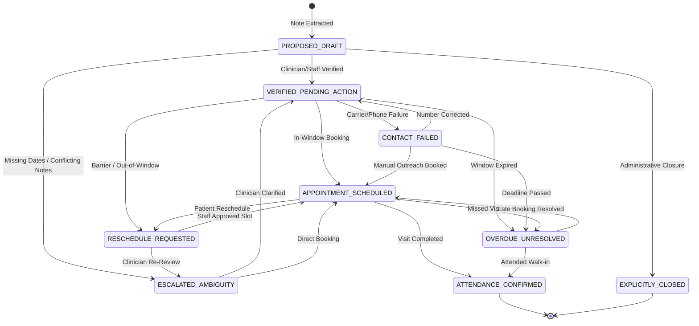

# FollowUp: Closed-Loop Hospital Follow-Up Coordination Platform
> **AI Synergy Hackathon 2026 — Healthcare Case 03 Submission**  
> *A human-supervised, closed-loop coordination engine tackling the outpatient follow-up blind spot without replacing hospital EHRs.*

---

## 1. Executive Summary & Core Operational Problem

In modern healthcare systems, post-discharge and outpatient follow-up care is plagued by the **Follow-Up Blind Spot**:
- **Static Discharge Notes:** Clinical follow-up orders are typically recorded as unstructured free-text inside discharge summaries or EHR notes. Once signed, they become passive text rather than active, monitored operational obligations.
- **The "Notification Illusion":** Most patient engagement tools equate *sending a notification* with *successful clinical follow-up*. In reality:
  $$\text{Reminder Sent} \neq \text{Reminder Delivered} \neq \text{Appointment Booked} \neq \text{Attendance Verified}$$
- **Disconnection from Patient Realities:** Patients encounter real-world logistical barriers (transportation, financial constraints, caregiver unavailability) or attempt to schedule outside clinician-safe windows, leading either to missed appointments or unmonitored clinical drift.

**FollowUp** solves this problem by transforming outpatient discharge instructions into **accountable, persistent lifecycle tasks** governed by a strictly deterministic state machine, verifiable character-level source grounding, and human-in-the-loop clinical supervision.

---

## 2. Key Architectural Principles & Safety Boundaries

FollowUp is architected according to non-negotiable healthcare safety principles:

| Principle | Implementation in FollowUp |
| :--- | :--- |
| **Zero Autonomous Clinical Decisions** | The platform contains **zero autonomous clinical-risk scoring**. Urgency levels are strictly derived from explicit clinician designation (`CLINICIAN_URGENT` vs `STANDARD`). |
| **Separation of Urgency & Lateness** | **Administrative lateness $\neq$ Clinical urgency.** When a task passes its window without attendance, it transitions to `OVERDUE_UNRESOLVED` to trigger triage, but the clinical `urgencyLevel` is never artificially modified. |
| **Clinical Authority Preservation** | Clinician-stipulated intervals are medically binding. In-window patient reschedule requests auto-confirm; **any out-of-window request is blocked from auto-confirmation** and routed to staff review (`OUT_OF_WINDOW_EXCEPTION`). |
| **Ambiguity & Conflict Blocking** | Missing timeframes, vague phrasing (`"PRN"`, `"as needed"`, `"soon"`), or conflicting intervals immediately trigger `ESCALATED_AMBIGUITY` and block automatic booking. |
| **Consent & Shared Phone Privacy** | Under Rule Set 2, shared household telephone numbers without explicit sensitive consent automatically redact diagnostic terminology and procedure names into neutral notices. |
| **Immutable Regulatory Auditability** | Every draft creation, AI extraction, state transition, staff override, and contact attempt is permanently recorded in an append-only `AuditLog` table. |

---

## 3. Candidate Novelties

1. **Character-Level Source-Grounded Extraction:**
   Every extracted follow-up parameter links directly back to exact character offsets (`start`, `end`, `exactQuote`) matching the clinician's notes. A strict validation guard rejects or escalates any extraction where `exactQuote !== sourceText.substring(start, end)`.
2. **Deterministic Lifecycle State Machine:**
   FollowUp replaces ad-hoc scheduling scripts with a mathematically modeled state machine graph. Illegal transitions (such as jumping from `PROPOSED_DRAFT` straight to `ATTENDANCE_CONFIRMED`) are blocked at the engine layer.
3. **Constraint-Aware Patient Rescheduling:**
   Patients can reschedule directly through an accessible portal, but the state machine enforces doctor-prescribed time bounds in real-time, preventing dangerous clinical drift.
4. **Attendance Barrier Triage:**
   Patients can report specific structural barriers (transportation, financial/insurance, caregiver unavailability, work conflict) which escalate directly to hospital social work and administrative coordinators.
5. **Consent-Aware Notification Dispatcher:**
   A communication engine that evaluates household telephone sharing and patient consent flags before dispatching SMS/WhatsApp/Call alerts, preserving patient dignity and compliance.

---

## 4. System Architecture

```
┌────────────────────────────────────────────────────────────────────────┐
│                        React 18 + Vite Frontend                        │
│  ┌───────────────────────┐ ┌──────────────────────┐ ┌────────────────┐ │
│  │ Clinician Order View  │ │ Staff Worklist Queue │ │ Patient Portal │ │
│  │ (Span Highlighting)   │ │ (Urgent vs Blocked)  │ │ (Reschedule)   │ │
│  └───────────────────────┘ └──────────────────────┘ └────────────────┘ │
│                                  │                                     │
│                     Tailwind CSS + Lucide Icons                        │
│                                  │ HTTP API                            │
└──────────────────────────────────┼─────────────────────────────────────┘
                                   ▼
┌────────────────────────────────────────────────────────────────────────┐
│                        Fastify (Node.js / TS)                          │
│                                                                        │
│   /api/tasks          /api/ai               /api/patient   /api/notif  │
│   (CRUD, Verify,      (Source-Grounded      (In-Window     (Consent-   │
│    Transitions)        Extraction Engine)    Reschedule)    Aware SMS) │
│                                  │                                     │
│   ┌──────────────────────────────┴─────────────────────────────────┐   │
│   │              Deterministic State Engine & Guardrails           │   │
│   │   • Character Span Offset Verification                         │   │
│   │   • Rule 1: Draft Creation & Verification Gates                │   │
│   │   • Rule 2: Shared Phone Redaction (Rule Set 2)                │   │
│   │   • Rule 3: Contact Failure Recovery (CONTACT_FAILED)          │   │
│   │   • Rule 4: Out-of-Window Escalation (RESCHEDULE_REQUESTED)    │   │
│   │   • Rule 5: Overdue Deadlines (OVERDUE_UNRESOLVED)             │   │
│   └──────────────────────────────┬─────────────────────────────────┘   │
└──────────────────────────────────┼─────────────────────────────────────┘
                                   ▼
┌────────────────────────────────────────────────────────────────────────┐
│                    SQLite Database (Prisma ORM)                        │
│   • Patient             • FollowUpTask        • ContactAttempt         │
│   • AuditLog (Immutable transition history & actor metadata)           │
└────────────────────────────────────────────────────────────────────────┘
```

### Technical Stack
- **Backend:** Node.js (TypeScript) + Fastify 5.
- **ORM & Database:** Prisma ORM with SQLite (zero-config, embedded, and instant evaluation).
- **Validation Engine:** Zod for runtime schema validation on all inputs, state transitions, and LLM outputs.
- **AI Extraction:** Dual-mode extractor supporting OpenAI / Groq structured JSON APIs with a deterministic offline mock fallback.
- **Frontend:** React 18, Vite, TypeScript, Tailwind CSS, Lucide React icons.

---

## 5. State Machine Lifecycle



---

## 6. Verification Matrix & Acceptance Test Coverage

The platform contains 35 automated test assertions across 4 test suites verifying the core criteria from the specification:

| Suite | File | Tests | Coverage |
| :--- | :--- | :---: | :--- |
| **Comprehensive Acceptance** | [`server/src/tests/acceptance.test.ts`](server/src/tests/acceptance.test.ts) | 7 | **AT-01 to AT-09** end-to-end criteria. |
| **AI Extraction & Grounding** | [`server/src/tests/aiExtraction.test.ts`](server/src/tests/aiExtraction.test.ts) | 12 | AT-01 clean spans, AT-02 missing dates, AT-02 vague PRN, AT-03 conflicts, span mismatch guards, urgency detection. |
| **Patient Privacy & Booking** | [`server/src/tests/patientCoordination.test.ts`](server/src/tests/patientCoordination.test.ts) | 7 | AT-04 shared phone redaction, AT-08 in-window vs out-of-window scheduling, barrier reporting. |
| **Task State Machine Engine** | [`server/src/tests/taskEngine.test.ts`](server/src/tests/taskEngine.test.ts) | 9 | Strict state transition rules, illegal jump rejection, contact failure handling, overdue scans. |

### Running the Test Suite
```bash
npm test
```
*Output: 35 passing tests across 4 suites with 0 failures.*

---

## 7. Quickstart & Installation Guide

### Prerequisites
- **Node.js:** v18.0.0 or higher
- **npm:** v9.0.0 or higher

### 1. Clone the Repository
```bash
git clone https://github.com/Follow-Plus/FollowPlus_Web.git
cd FollowPlus_Web
```

### 2. Install Dependencies
```bash
npm install
```

### 3. Initialize & Seed Database
```bash
npm run db:generate
npm run db:migrate
npm run db:seed
```
*This initializes SQLite and seeds synthetic patient records modeling the 6 core clinical edge cases (standard post-op, shared household phone, carrier drop, unbounded PRN note, conflicting intervals, and clinician urgent AKI monitoring).*

### 4. Run Automated Test Verification
```bash
npm test
```

### 5. Build for Production
```bash
npm run build
```

### 6. Start Development Environment
```bash
npm run dev
```
- **Backend API:** `http://localhost:3001`
- **Frontend Portal:** `http://localhost:5173`

---

## 8. Interactive Evaluator Walkthrough (Demo Controller)

To make evaluation seamless during hackathon review, a floating **"AI Synergy Demo Controller"** is built into the bottom-right corner of the web UI. Clicking it opens one-click walkthroughs for the 6 core scenarios:

1. **Scenario 1: Standard Follow-Up & Self-Scheduling**
   - *Patient:* David Miller (`MRN-1001`)
   - Demonstrates clear 10–14 day window and automated in-window slot confirmation.
2. **Scenario 2: Shared Phone Diagnostic Privacy (Rule Set 2)**
   - *Patient:* Maria Gonzalez (`MRN-1002`)
   - Demonstrates oncology pathology instructions automatically redacted into neutral alerts on shared telephone lines.
3. **Scenario 3: Carrier Delivery Failure Recovery**
   - *Patient:* Robert Chen (`MRN-1003`)
   - Demonstrates invalid destination numbers routing directly into `CONTACT_FAILED` for staff triage.
4. **Scenario 4: Ambiguous Note & Vague Phrasing Block**
   - *Patient:* Emily Davis (`MRN-1004`)
   - Demonstrates `"PRN"` and `"as needed soon"` triggering `ESCALATED_AMBIGUITY` with visible alert banners.
5. **Scenario 5: Conflicting Temporal Intervals**
   - *Patient:* Michael Brown (`MRN-1005`)
   - Demonstrates `"in 2 weeks"` vs `"in 6 months"` detected as conflicting spans, blocking automated booking.
6. **Scenario 6: Out-of-Window Rescheduling Request**
   - Demonstrates patient requesting a date outside the doctor's approved window, automatically escalating to `RESCHEDULE_REQUESTED` with `OUT_OF_WINDOW_EXCEPTION`.

---

## 9. Project Structure

```
Follow_plus/
├── SPECIFICATION.md                 # System requirements and technical specification
├── package.json                     # Monorepo workspace configuration
├── client/                          # React + Vite frontend
│   ├── src/
│   │   ├── components/
│   │   │   ├── ClinicianEditor.tsx  # Source span highlighting & structured editor
│   │   │   ├── StaffDashboard.tsx   # Urgent & outstanding queues + action modal
│   │   │   ├── PatientPortal.tsx    # In-window scheduling & barrier reporting
│   │   │   ├── AuditLogViewer.tsx   # Immutable regulatory event ledger
│   │   │   └── DemoSwitcher.tsx     # One-click hackathon scenario controller
│   │   ├── services/
│   │   │   └── api.ts               # Typed Fastify client service
│   │   ├── types/
│   │   │   └── index.ts             # Shared frontend domain interfaces
│   │   ├── App.tsx                  # Hospital navigation & responsive layout
│   │   └── main.tsx
│   └── vite.config.ts
├── server/                          # Fastify backend
│   ├── prisma/
│   │   ├── schema.prisma            # Prisma SQLite relational schema
│   │   ├── seed.ts                  # Synthetic clinical edge cases
│   │   └── migrations/
│   └── src/
│       ├── routes/
│       │   ├── tasks.ts             # CRUD, verification, transitions, queues
│       │   ├── ai.ts                # POST /api/ai/extract-instruction
│       │   ├── patient.ts           # Reschedule & barrier reporting endpoints
│       │   └── notifications.ts     # Simulated outbound notice dispatch
│       ├── services/
│       │   ├── taskEngine.service.ts    # Deterministic state machine & audit logger
│       │   ├── aiExtraction.service.ts  # Traceable span extractor & ambiguity guards
│       │   └── notification.service.ts  # Rule Set 2 consent-aware communicator
│       ├── tests/
│       │   ├── acceptance.test.ts       # AT-01 to AT-09 criteria verification
│       │   ├── aiExtraction.test.ts     # Character span & ambiguity test suite
│       │   ├── patientCoordination.test.ts # Shared phone & window guard tests
│       │   └── taskEngine.test.ts       # State transition & lifecycle tests
│       ├── types.ts                 # Enums & Zod runtime schemas
│       ├── db.ts                    # Prisma client singleton
│       └── index.ts                 # Fastify server entrypoint
└── README.md
```

---

## 10. License & Submission Control
Developed for the **AI Synergy Hackathon 2026** (Healthcare Case 03: Closed-Loop Outpatient Follow-Up).  
All rights reserved. Designed for deployment alongside existing hospital EHR platforms.
